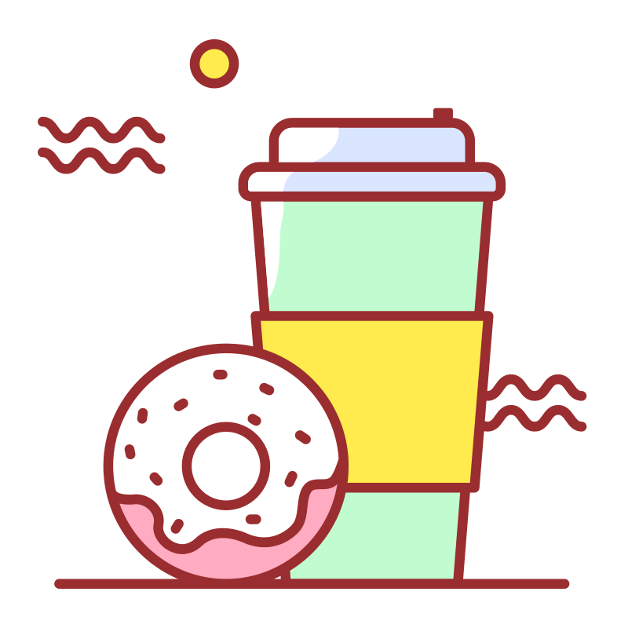
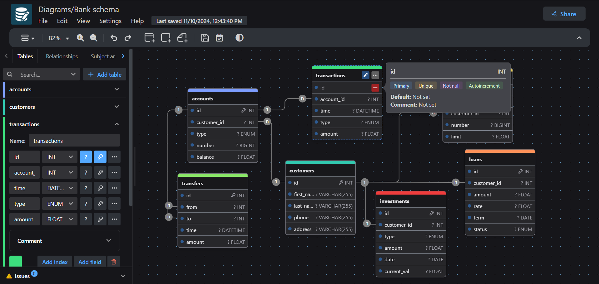

<p align="center">
  
</p>

<h1 align="center">Portafolio de Oscar Valenzuela</h1>

<p align="center">Aplicaciones web, herramientas interactivas y retos de Frontend Mentor.</p>

<p align="center">
  
  
  
</p>

<p align="center">
  <strong><a href="https://portafolio-six-smoky.vercel.app/">Explorar el portafolio</a></strong>
  · <a href="#proyectos-destacados">Proyectos destacados</a>
  · <a href="#desarrollo-local">Desarrollo local</a>
</p>

---

El catálogo reúne **16 demos de Frontend Mentor y 4 proyectos independientes**. Puedes buscar por nombre, combinar filtros de tecnologías frontend y backend, y recorrer los resultados por páginas. Tus filtros se guardan en el navegador.

## Proyectos destacados

### Nodia-DB

Modela bases de datos con un editor visual de diagramas entidad-relación y exporta el esquema a SQL sin crear una cuenta. [Abrir Nodia-DB](https://nodia-db.pages.dev/)



| Proyecto                   | Qué puedes hacer                                                                    | Enlaces                                                                                                                                                          |
| -------------------------- | ----------------------------------------------------------------------------------- | ---------------------------------------------------------------------------------------------------------------------------------------------------------------- |
| **Products**               | Explorar un blog reutilizable con demos temáticas y contenido gestionado en Strapi. | [Ver Products](https://products-blog-client.vercel.app/) · [Código de Products](https://github.com/oscarvalenzuela25/Products)                                   |
| **Task Board App**         | Organizar tareas en un tablero que guarda los datos localmente con IndexedDB.       | [Abrir Task Board](https://task-board-app.pages.dev/) · [Código de Task Board](https://github.com/oscarvalenzuela25/Task-Board-App)                              |
| **Password Generator App** | Generar contraseñas desde el navegador.                                             | [Abrir el generador](https://password-generator-app-five-beta.vercel.app/) · [Código del generador](https://github.com/oscarvalenzuela25/Password-Generator-App) |

## Retos de Frontend Mentor

- [Dashboard de redes sociales](https://portafolio-six-smoky.vercel.app/12-social-media-dashboard-with-theme-switcher) con cambio de tema.
- [Formulario de registro](https://portafolio-six-smoky.vercel.app/6-intro-component-with-sign-up-form) con validación de campos.
- [Componente de valoración](https://portafolio-six-smoky.vercel.app/16-star-rating-component) con selección de una a cinco estrellas.

## Desarrollo local

Con **Node.js 22 o posterior** y npm, ejecuta estos comandos desde una terminal.

```sh
git clone https://github.com/oscarvalenzuela25/Portafolio.git
cd Portafolio
npm ci
npm run dev
```

El sitio se abre en [localhost:4321](http://localhost:4321). El catálogo lee un archivo JSON local, así que puedes explorarlo sin configurar una API.

| Comando           | Qué hace                                                           |
| ----------------- | ------------------------------------------------------------------ |
| `npm run lint`    | Analiza el código con ESLint.                                      |
| `npm run build`   | Ejecuta `astro check` y genera el sitio estático en `dist/`.       |
| `npm run preview` | Sirve el sitio generado para revisarlo en local después del build. |

## Estructura del proyecto

| Ruta                                               | Contenido                                                                                                 |
| -------------------------------------------------- | --------------------------------------------------------------------------------------------------------- |
| [`src/pages/`](./src/pages/)                       | Portada y rutas públicas de las demos.                                                                    |
| [`src/modules/Projects/`](./src/modules/Projects/) | Catálogo en React, con TanStack Query para gestionar los resultados y Zustand para persistir los filtros. |
| [`src/landing-projects/`](./src/landing-projects/) | Implementación y estilos de cada reto.                                                                    |
| [`src/db/projects.json`](./src/db/projects.json)   | Datos, tecnologías y enlaces de los proyectos.                                                            |

---

Desarrollado por **Oscar Valenzuela** · [GitHub](https://github.com/oscarvalenzuela25) · [LinkedIn](https://www.linkedin.com/in/oscar-valenzuela-rojas-8b54701aa/)
